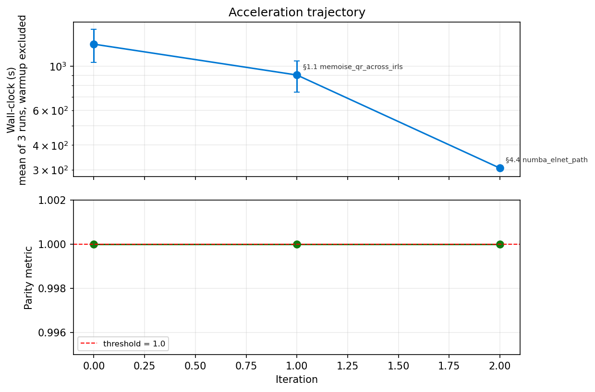

# Reconstruction Report — py-Pando

> Written after the parity gates were evaluated and the Acceleration loop stopped (omicverse-rebuildr PROTOCOL Step 5).

## 1. Identity

| Field | Value |
|---|---|
| Python package | `pypando` 0.1.0 |
| Upstream R package | Pando 1.1.1 (quadbio/Pando @ e8abb30, 2026-10-13) |
| Upstream source | https://github.com/quadbio/Pando (MIT) |
| Algorithm class | mixed: 14 outputs, each with its own pre-registered gate (`data/manifest.yaml`) |
| Parity threshold (pre-registered) | per output; see §3.1 |
| Final parity value | 13 of 14 gates pass against the installed R reference. The failing gate, `xgb_gain`, passes with value 1.0 when R honours Pando's xgboost parameters, which R xgboost ≥ 3 drops (§3.3). |
| Audit class | **B**: translation, plus exact BLAS-call reproduction for bit-identity, and two admissible accelerations |
| Total LOC (`pypando/`) | 3,522 Python (R source: 3,404 lines, including 651 of plotting) |
| Wall-clock vs R | `infer_grn(glm)`: 121 s vs 141 s (1.16×). `find_motifs`: 103 s vs 141 s on all regions (near-target scanning scans 4,623 of 8,127). `glmnet`, `xgb`, `bagging_ridge`: slower than R (§3.2). |
| Memory tractability | not measured as a gain (same algorithms) |

## 2. R function coverage audit

Automatic audit: `AUDIT.md` (`engine.r_function_audit`). Statuses were reviewed by hand in `port.yaml`.

### 2.1 Exported R functions

| R function | Python | Status | Tests / evidence | Notes |
|---|---|---|---|---|
| `initiate_grn` | `initiate_grn` | ✅ | fixture: identical regions | Seurat object becomes RNA + ATAC AnnData plus annotation |
| `find_motifs` | `find_motifs` | ✅ | fixture: identical motif matrix | same MOODS library; FASTA in place of BSgenome |
| `find_peaks_near_genes` | `find_peaks_near_genes` | ✅ | fixture + notebook 3: identical (Signac, GREAT) | |
| `infer_grn` / `fit_grn_models` | same | ✅ | fixture gates | `parallel` is accepted but runs sequentially |
| `fit_model`, `fit_glm`, `fit_glmnet`, `fit_cvglmnet`, `fit_xgb`, `fit_bagging_ridge`, `fit_bayesian_ridge` | same | ✅ | notebook 3, about 1e-14 | `fit_glmnet`'s R default family (the *function* `gaussian`) is not ported (§3.3) |
| `fit_brms` | `fit_brms` | ⛔ raises | — | Stan / brms |
| `format_coefs` | same | ✅ | notebook 3 | |
| `find_modules` | same | ✅ | fixture: identical modules | |
| `get_network_graph` | same | ✅ graph | tutorial | layout through umap-learn, not uwot's random stream |
| `get_tf_network`, `plot_tf_network` | — | ⛔ skipped | — | With Pando's default `keep_all_edges = FALSE`, `get_tf_network` filters on a column (`mean_padj`) it never creates, so for glm networks it errors in R |
| `plot_gof`, `plot_module_metrics`, `plot_network_graph` | same | ✅ (matplotlib) | tutorial | |
| `coef`, `gof`, `GetNetwork`, `GetGRN`, `DefaultNetwork`, `NetworkFeatures`, `NetworkTFs`, `NetworkRegions`, `NetworkModules`, `NetworkParams`, `NetworkGraph`, `Params` | same | ✅ | tutorial | |
| `create_GRNData`, `aggregate_assay`, `GetAssaySummary`, `aggregate_matrix`, `sparse_cor` | same | ✅ | notebook 3 | |
| `GRNData`, `RegulatoryNetwork`, `Regions`, `Network`, `Modules` (classes) | dataclasses | ✅ | | |
| `GetAssay`, `LayerData`, `VariableFeatures` | — | ⛔ skipped | | Seurat generics; AnnData attributes in Python |
| `map_par` | — | ⛔ skipped | | R parallelism helper |
| `no_legend`, `no_margin`, `no_x_text`, `no_y_text`, `print` | — | ⛔ skipped | | ggplot2 theme helpers and print methods (each class has a `__repr__`) |

### 2.2 Internal helpers reachable from exports

| R helper | Used by | Python | Status |
|---|---|---|---|
| `sparse_covcor` | `sparse_cor` | inlined in `sparse_cor` | ✅ |
| `fast_aggregate`, `dMcast`, `extract_rows` | `aggregate_matrix` | inlined | ✅ |
| `r2`, `rse`, `sse` | model fits | `models.r2` | ✅ |
| `motifmatchr_patched.R` (`convert_pwm_fixed`, `get_bg_fixed`, `match_motifs_fixed`, `add_motifs_fixed`) | `find_motifs` | `motifs.py` | ✅ |

R-side primitives reproduced with R's semantics:
- `glm.fit` / `summary.glm` / LINPACK `dqrdc2` / `dqrsl` (`rstats.py`, `_blas.py`);
- `p.adjust`;
- `wilcox.test` (R 4.4) and `t.test`;
- `set.seed` / `sample` (`rrng.py`);
- glmnet's elnet path and `cv.glmnet` (glmnet 5.0);
- `TFBSTools::toPWM`;
- Signac `Extend` / `StringToGRanges`;
- GenomicRanges `findOverlaps` / `subtract` / `reduce` / `pintersect`.

### 2.3 Coverage summary

| Category | Coverage |
|---|---|
| Exported R functions (51) | 39 ported (including 4 classes), 12 skipped with a reason (`port.yaml`). Every algorithmic export is ported except `fit_brms` and `get_tf_network` / `plot_tf_network`. |
| Internal helpers reachable from exports | 7 / 7 |

### 2.4 Deliberately skipped

| R function | Reason |
|---|---|
| `fit_brms` | Bayesian models through Stan (`brms`); would need a Stan toolchain |
| `get_tf_network`, `plot_tf_network` | errors in R for glm networks at default settings (see §2.1) |
| ggplot2 theme helpers, `print` methods, `map_par`, Seurat accessor generics | plotting / R plumbing |

### 2.5 Dependencies reused from omicverse

None; see `DISCOVERY.md`. The three automatic matches (py-cca, anndata-oom, py-monocle2/py-dada2) were spurious for Pando's use. Native replacements:
- MOODS-python: the same C++ library that motifmatchr bundles;
- pyfaidx;
- scikit-learn: the same estimators Pando calls through reticulate;
- xgboost;
- NumPy / SciPy, linked to the same OpenBLAS as R.

## 3. Parity evidence

### 3.1 Per-output parity

Fixture: 10x Multiome PBMC 10k, 2,000 cells, 150 targets, 7,141 peaks, 8,127 candidate regions. R 4.4.3 with OpenBLAS 0.3.34 and one BLAS thread; Python with the same OpenBLAS and one thread.

| Output | Class | Threshold | Final value | Pass |
|---|---|---|---|---|
| candidate_regions (also with `regions = phastCons`) | deterministic-strict | identical | identical: 8,127 rows; 7,130 with phastCons | ✅ |
| peaks_near_genes_signac | deterministic-strict | identical | identical: 198,776 hits | ✅ |
| peaks_near_genes_great | deterministic-strict | identical | identical: 96,699 hits | ✅ |
| motif_matrix | classification | agreement ≥ 0.9999, Jaccard ≥ 0.999 | 1.0 / 1.0 (1,240,962 hits, 0 differences) | ✅ |
| glm_keys | deterministic-strict | identical | identical (24,642 rows) | ✅ |
| glm_coefficients | deterministic-standard | max \|Δ\| / (1e-8 \|ref\| + 1e-10) ≤ 1 | 9.8e-7 (estimate), 7.6e-7 (SE), 9.2e-7 (t), 4.6e-7 (rsq), 7.8e-6 (corr) | ✅ |
| glm_pvalues | inference | max \|Δ −log10 p\| ≤ 1e-6, Spearman ≥ 0.9999 | 4.0e-13 (p), 3.9e-13 (padj), Spearman 1 − 1.2e-12 | ✅ |
| glmnet_coefficients | ordinal | Pearson ≥ 0.999, support Jaccard ≥ 0.95, λ rel ≤ 1e-4 | 0.99985 / 0.99898 / 1.7e-13 | ✅ |
| cvglmnet_coefficients | ordinal | same | 1.0 / 1.0 / 9.7e-14 (coefficients within 5e-14) | ✅ |
| xgb_gain | ranked | median per-target Spearman ≥ 0.9, top-10 Jaccard ≥ 0.8 | **0.815 / 0.667** against installed R; **1.0 / 1.0** with Pando's params honoured | ❌ / ✅ (§3.3) |
| bagging_ridge | deterministic-standard | normalised error ≤ 1, Δ −log10 p ≤ 1e-6 | 9.9e-7 / 4.3e-13 | ✅ |
| bayesian_ridge | deterministic-standard | same | 9.8e-7 (estimate), 9.9e-7 (variance) / 3.8e-13 | ✅ |
| modules | classification | mean Jaccard ≥ 0.99, TF-set Jaccard = 1 | 1.0 / 1.0 (104 modules) | ✅ |

Per-function parity on a separate deterministic design (notebook 3):
- `fit_glm` 6e-14;
- `fit_glmnet` 1e-14;
- `fit_cvglmnet` 2e-14;
- `fit_xgb` (params honoured) 2e-15;
- `fit_bagging_ridge` 1e-14;
- `fit_bayesian_ridge` 4e-13;
- `format_coefs` 6e-14;
- `sparse_cor` 1e-15;
- `aggregate_matrix` ≤ 5e-13;
- `find_peaks_near_genes`: identical.

### 3.2 Wall-clock on the fixture

Single BLAS thread. The node is shared, so Python timings vary by about 10%.

| Step | R | Python | Note |
|---|---|---|---|
| `find_motifs` (all 8,127 regions) | 141 s | 103 s | `subset_regions` scans 4,623 of them (not timed separately) |
| `infer_grn(glm)` | 141 s | 121 ± 11 s | memoised BLAS-exact QR |
| `infer_grn(glmnet)` | 49 s | 76–185 s | compiled coordinate descent without strong-rule screening |
| `infer_grn(cv.glmnet)` | 286 s | 483 s | |
| `infer_grn(xgb)` | 241 s | 548 s | not comparable: R trains depth 6, lr 0.3; Python depth 3, lr 0.01 |
| `infer_grn(bagging_ridge)` | 337 s | 784 s | |
| `infer_grn(bayesian_ridge)` | 25 s | 105 s | |

### 3.3 Divergences, stated plainly

1. **xgb.** Pando calls `xgboost::xgboost(data, label, params = list(max_depth = 3, eta = 0.01), nrounds = 1000, nthread = 1)`. In R xgboost ≥ 3 (the reference has 3.4.2.1), `xgboost()` takes `x, y, max_depth, learning_rate, nthreads, …` and silently drops `params` and `nthread`, so the installed Pando trains with xgboost's defaults. py-Pando follows Pando's source. The gate was not widened.
   - Diagnostic: `PANDO_XGB_HONOUR_PARAMS=1 Rscript tests/r_reference_driver.R …` reruns Pando with `fit_xgb` patched to `xgb.train` with Pando's params. Against that, all 10,087 importance rows match within 2e-16 and rsq within 4e-16.
2. **glmnet.** Lambdas are identical on every gene. For genes with hundreds of variables, the coefficients differ by up to 0.16 (TCF7L2, 1,049 variables): both solvers stop within glmnet's 1e-7 tolerance, but glmnet 5.0 screens variables with strong rules and py-Pando's coordinate descent does not. cv.glmnet is exact, because at `lambda.1se` the solutions are sparse and well determined.
3. **`fit_glmnet` default family.** R's default is the function `gaussian`, which sends glmnet to its generic `glmnet.path` solver. `infer_grn` always passes the string `"gaussian"`, which takes the elnet path. py-Pando ports the string path only.
4. **glm bit-identity needs the same BLAS.** The glm network is bit-identical to R's when both use the same BLAS build and one BLAS thread. With another BLAS, near-collinear designs at the `dqrdc2` 1e-11 pivot tolerance can alias different columns, as R itself would with another BLAS.
5. **`aggregate_rna_col` / `aggregate_peaks_col`.** Not supported: Pando reads `object@meta.data` from a `GRNData`, which has no such slot, so these options error in R.

### 3.3b R's control flow reproduced at the edges

These details were found from fixture discrepancies, see `examples/evolution.ipynb`:
- glmnet rejects one-column designs, so Pando skips those genes.
- `cv.glmnet` draws its folds before that error, so R's random stream still advances.
- R 4.4's `wilcox.test` returns NaN (not an error) when every bag coefficient is 0.
- Pando's `VariableFeatures` / `LayerData` generics mask Seurat's.

### 3.4 Reference commands

```bash
python tests/make_fixture.py <10x filtered_feature_bc_matrix.h5> data/fixture
Rscript tests/r_reference_driver.R data/fixture ref                    # + RETICULATE_PYTHON for the ridge methods
Rscript examples/r_per_function_dump.R ref_fn
python tests/_run_candidate.py ref cand hg38.fa
python tests/parity_check.py ref cand results.json
PYPANDO_REF_DIR=ref PYPANDO_FASTA=hg38.fa PYPANDO_CAND_DIR=cand pytest tests/test_exact_match.py
```

## 4. Acceleration evidence

### 4.1 Two-plot evaluation



Per-iteration narrative: `examples/evolution.ipynb`. The log is `ITERATION_LOG.md`. The benchmark is `infer_grn(glm)` + `infer_grn(glmnet)` on the fixture, one warm-up and three runs.

### 4.2 Accepted rewrites

| Iter | Section | Admissibility | Wall-clock | Speedup | Accuracy delta |
|---|---|---|---|---|---|
| 0 | baseline (BLAS-exact QR every IRLS step; interpreted glmnet) | — | 1,293 s | 1× | — |
| 1 | §1.1 memoise the QR across IRLS iterations | E | 903 s | 1.43× | 0 (bit-identical) |
| 2 | §4.4 numba coordinate descent | B (≤ 4.4e-13 per entry, MATH.md §2) | 306 s | 4.22× | 0 at gate resolution |

Outside the R API, exact (MATH.md §3): near-target motif scanning cuts the regions scanned by 43% on the fixture.

### 4.3 Rejected / not pursued

The remaining glm cost is the BLAS-exact QR itself. Replacing it with a faster QR (LAPACK `dgeqp3`, or a vectorised NumPy loop) changes the pivot decisions on near-collinear designs. That breaks bit-identity, and on BACH2 it breaks the glm gates. It is inadmissible.

## 5. Code quality audit

| Check | Status |
|---|---|
| `pip install .` and import in a clean environment | ✅ |
| `pytest -q` | ✅ 9 smoke tests without R; `test_exact_match.py` passes 13 of 14 gates, with `xgb_gain` failing as in §3.3 (it skips without `PYPANDO_REF_DIR` / `PYPANDO_FASTA`) |
| `examples/compare_R_vs_Python.ipynb` (6 sections, executed) | ✅ |
| `examples/tutorial_pbmc10k_multiome.ipynb` (one subsection per public function, executed) | ✅ |
| `examples/function_by_function_R_parity.ipynb` (parameter tables, executed) | ✅ |
| `examples/evolution.ipynb` (iterations 0–7, executed) + `examples/evolution.png` | ✅ |
| `examples/r_per_function_dump.R` | ✅ |
| `README.md`, `MATH.md`, `ITERATION_LOG.md`, `DISCOVERY.md`, `AUDIT.md`, `port.yaml` | ✅ |
| License | ✅ MIT (as upstream) |
| Version | ✅ 0.1.0 |
| GitHub repo | ✅ https://github.com/omicverse/py-Pando (data assets: release `data-v1`) |
| PyPI release | ⏳ left to the maintainer (build and `twine check` pass) |

## 6. Known limitations

- `fit_brms`, `get_tf_network` and `plot_tf_network` are not ported.
- glmnet without strong rules: slower than R, and tolerance-level differences on very wide designs.
- Bit-identity of glm statistics needs the same BLAS build and one BLAS thread; otherwise expect agreement to about 1e-12 on most genes, with possible aliasing differences on near-singular designs.
- `get_network_graph` UMAP coordinates differ from R's (uwot vs umap-learn).

## 7. Integration

Epione wraps py-Pando as `epione.grn.pando` (aristoteleo/epione PR #75).

## 8. Sign-off

2026-10-13 — agent P (Claude, Epione session). Active time: one working session.
